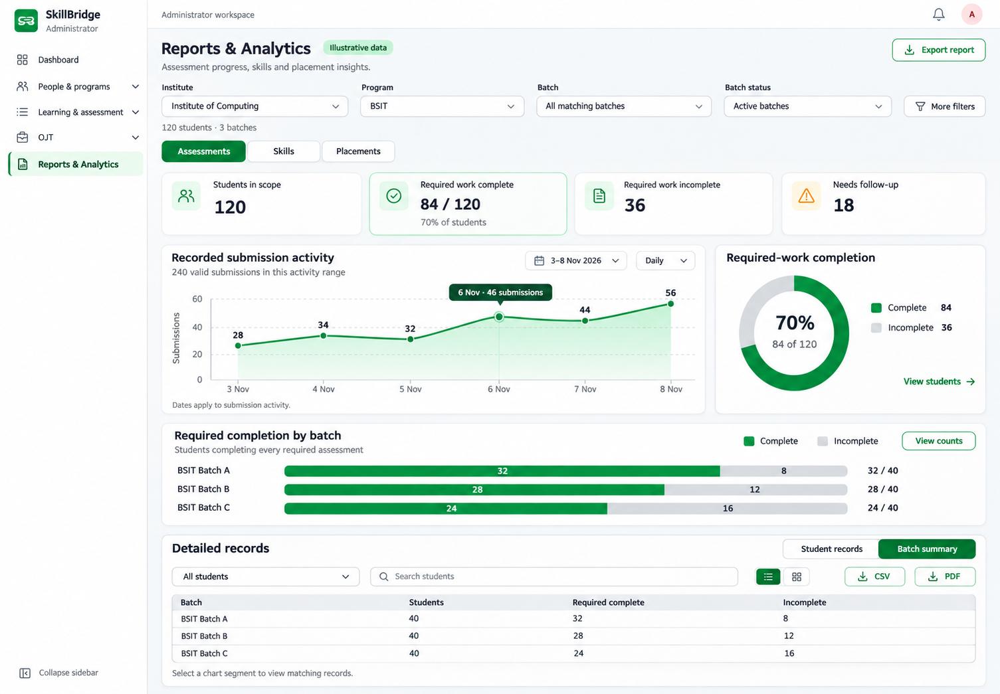
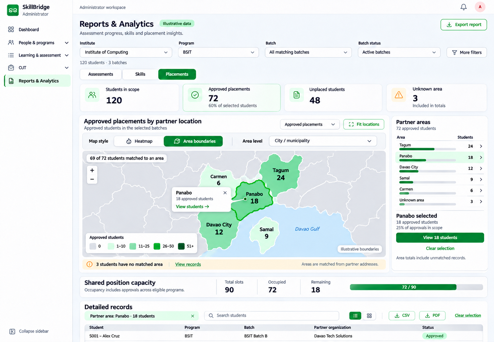
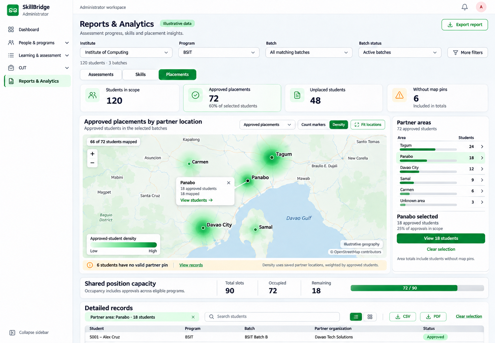
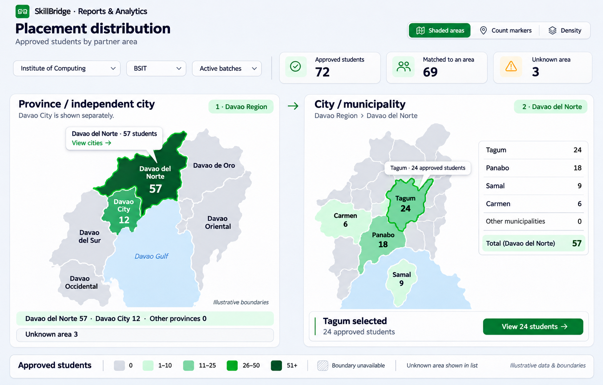

# Analytics charts and placement map design plan

Prepared and feasibility-reviewed 8 November 2026. First implementation delivered
9 November 2026; see the [implementation receipt](ANALYTICS_MAP_REDESIGN_IMPLEMENTATION.md)
for the delivered behavior, resolver/boundary scope and validation. The design
and proposed enhancements below retain their original review context.
Original design deliverables are this plan, four
full-resolution Imagegen concepts, the user's two map-review screenshots and four
original inspiration images. The saved designs cover charts and placement maps
for administrator and instructor/coordinator Reports & Analytics.

**Feasibility verdict:** the current React/Recharts/Leaflet stack can support the
redesign. Chart styling can reuse existing data. The complete map feature also
needs backend changes, a compatible heat layer and validated administrative
boundary data. Existing map services alone do not supply these student counts or
city/province polygons.

### Full-screen preview set · 9 November 2026

The [eight-screen preview gallery](../output/design/analytics-preview-2026-11-09/README.md)
now shows Assessments, Skills and Placements for each staff role, the admin
province/independent-city map state and the instructor placement-workspace map
entry. It supplements the original concepts below and uses the same count/access
contracts. Both roles can use both map styles; their example screenshots show
different styles to make the review set useful. These are generated design
previews with synthetic data and illustrative geometry. Implementation status
and verification are recorded in the implementation receipt. The instructor
placement workspace receives only the map-entry button; its preview's broader
workspace styling is not applied.

## Accepted implementation refinement · 9 November 2026

The user requested visible chart sections rather than accordions, closer preview
layout, a tile-free outline of the whole Philippines, a partner-only side list,
and Suggested as well as Approved map views. The implementation receipt records
this accepted scope change. It supersedes the original Davao-only geography and
approved-only map measure below. Instructor Placement Management keeps its UI;
only its existing map-entry button is added.

## Review concepts

Built-in Imagegen produced these desktop concepts. Figures are synthetic and
geographic shapes are illustrative. The placement preview shows Density mode;
the latest refinement puts Heatmap and Area boundaries in a single map panel.
Review the screen hierarchy, chart treatment, map controls and record drilldown
together.

### Assessment analytics

### Latest map control refinement

The same map panel has a Heatmap / Area boundaries switch. This concept shows
Area boundaries selected, revealing the City / municipality level selector.
It uses synthetic data and illustrative boundaries. Its exact
[generation prompt](../output/design/analytics-review-2026-11-08/MAP_STYLE_SWITCH_PROMPT.md)
is saved with the preview.

### Placement geography

### Province and city shaded-area drilldown

This comparison shows two navigation states. A province selection opens its
city/municipality map. The generated boundaries are illustrative.

Exact generation prompts are saved in the
[prompt record](../output/design/analytics-review-2026-11-08/IMAGEGEN_PROMPTS.md).
The additional shaded-area concept has its own
[generation prompt](../output/design/analytics-review-2026-11-08/CHOROPLETH_PROMPT.md).

The [saved-image inventory](../output/design/analytics-review-2026-11-08/README.md)
identifies every preview, original inspiration image and user screenshot. Use the
assessment concept for chart presentation and the latest map-style concept for
the shared map controls. Earlier concepts record the design's other states.

## Design brief

Use the user's three analytics references for their chart hierarchy, spacious
white panels, clear legends and compact summary cards. Apply SkillBridge's green
theme, shared icons, readable compact text and established navigation.

The review covers Reports & Analytics for administrators and instructors. Keep
the existing Assessments, Skills and Placements sections. Place geographic
analysis inside Placements so its purpose and student population are explicit.

Follow the [UI design guide](UI_DESIGN_GUIDELINES.md),
[animation guide](UI_ANIMATION_GUIDELINES.md) and collection interaction contracts.

## What the current application provides

| Area | Current capability | Design implication |
| --- | --- | --- |
| Report scope | Institute, program, batch, batch status, instructor and course | A compact primary scope row with additional filters in a disclosure |
| Assessments | Required completion by batch, current attempt states and recorded valid submission activity | Compare completion with bars and show activity as a time series |
| Skills | Final category score bands and each student's highest current recommendation band | Keep category/framework identity, sample size and missing evidence visible |
| Placements | Selected-batch approvals, approvals in another batch, unplaced students, partner/area totals and shared position capacity | Show distinct student states and label shared capacity separately |
| Geographic totals | Partner-area approvals, residents, unplaced residents, partner counts and slot counts | Provide an explicit measure selector and an exact-count list |
| Partner map | Saved coordinates, Leaflet/OSM, invalid-coordinate handling and missing-location count | Reuse the existing map foundation for a scoped analytics layer |
| Records and exports | Chart selections, area/company drilldown, search, sorting, pagination and CSV/PDF snapshots | A chart or map selection opens matching detailed records |

Source review used the current frontend report page, analytics components,
`src/utils/analytics.js`, `src/utils/partnerMap.js`, the admin partner map,
`api/analytics.py` and the Company model. The full source map appears below.

## Verified map and backend feasibility

This review inspected source and official documentation. It establishes a
supported implementation approach; it does not establish production address
quality, acquire a boundary dataset or prove a plugin integration in the browser.

| Part | Verified current implementation | Required work |
| --- | --- | --- |
| Charts | Recharts 3.10.1; existing area, bar, stacked-bar and doughnut components | Apply the saved layout, styling and interaction design to all three report sections |
| Map renderer | `loadLeaflet()` loads Leaflet 1.9.4 from cdnjs; existing maps handle saved pins, resize, fit, retries and cleanup | Reuse the loader and lifecycle for one report map with interchangeable layers |
| Heatmap | No heat-layer dependency or loader exists in the current frontend | Add a pinned compatible heat renderer; use approved-student counts as weights |
| Area boundaries | Leaflet supports GeoJSON polygon styling and feature events; no boundary assets or polygon report layer are currently present | Obtain and validate city/province geometry, join by canonical IDs and add selection/legend behavior |
| Basemap | Existing maps use OpenStreetMap raster tiles | Keep a configurable provider, attribution, loading/failure handling and compliant tile requests |
| Address lookup | AddressDropdowns uses `psgc.gitlab.io/api`; selected codes stay inside the component while name fields are emitted | Persist validated canonical IDs and catalog version, including independent-city handling |
| Geocoding | Nominatim search returns a possible coordinate for an address; form fallback centers are approximate | Use saved verified partner pins for analytics; do not geocode every student/report refresh |
| Analytics API | `/api/management/analytics/` already provides scoped students, placement states, company/area counts and shared capacity | Add approved-cohort geographic aggregates, valid-pin weights, canonical IDs and coverage metadata |
| Storage | Company already has JSON address plus nullable latitude/longitude; User has a JSON address | Extend validated address data compatibly; audit/backfill legacy names without overwriting the existing labels |
| Staff access | Managed-batch authorization and institute/program filters already exist | Preserve those checks for aggregates, selections, records and exports |

Leaflet's [stable 1.9.4 reference](https://leafletjs.com/reference-1.9.4.html#geojson)
documents GeoJSON layers, polygon styles and feature events. This supports the
boundary rendering approach without requiring a map-platform replacement.

The [Leaflet.heat maintainer documentation](https://github.com/Leaflet/Leaflet.heat)
supports weighted points and Leaflet 1.9. Its current global build is
`dist/leaflet-heat-global.js`; it exposes `L.heatLayer` with Leaflet 1.x. Evaluate
and pin the exact artifact/version/license with the existing global loader, then
prove rendering, cleanup and retry behavior in a small integration spike. Do not
mix the module/global builds or copy Leaflet 2-only APIs into this 1.9.4 app.

### Map service responsibilities

The renderer draws overlays; raster tiles provide the background; geocoding
finds a point; the address catalog supplies names/IDs. SkillBridge's backend
provides authorized student counts. A separate versioned boundary artifact
supplies polygon geometry. Successful address search does not establish polygon
coverage or a correct approval count.

Follow the [OSM tile policy](https://operations.osmfoundation.org/policies/tiles/):
use its documented HTTPS tile URL, visible attribution, valid browser Referer
and normal caching. Avoid bulk tile prefetch. Public service is best-effort;
evaluate a suitable provider if deployment traffic or availability requires it.
The current `{s}.tile.openstreetmap.org` configuration should be normalized to
the documented provider URL during implementation.

The existing public [Nominatim service policy](https://operations.osmfoundation.org/policies/nominatim/)
limits total application traffic to one request per second, requires identifying
requests and discourages repeated/bulk geocoding. Keep analytics independent of
new geocoding calls. Any future address-search changes need shared throttling,
caching and provider configuration rather than a per-browser request assumption.

### Boundary data release gate

Boundary data is a pending dependency. The
[PSA PSGC directory](https://psa.gov.ph/classification/psgc) is the identity
reference. [Geoportal Philippines](https://geoportal.gov.ph/) is a candidate
source to investigate; this review has not obtained a reusable licensed boundary
package. A portal page or tile image alone is insufficient.

Before releasing Area boundaries mode:

1. Select province/independent-city and city/municipality artifacts with explicit
   source, permission/license, attribution, release date and geographic coverage.
   Record whether the boundaries are administrative, approximate or disputed.
2. Freeze a compatible PSGC catalog and crosswalk. Keep IDs as strings, retain
   leading zeros and record the code scheme/release. Check the existing address
   API's code vintage against it; do not join two versions by assumption.
3. Prepare WGS84 GeoJSON, preserving MultiPolygons, islands, coastlines and
   parent identities. Validate geometry and simplify a web copy without erasing
   small areas. Keep original source/checksum and a repeatable conversion recipe.
4. Verify unique feature IDs, required Davao coverage and nonoverlapping Davao
   City/province geometry. Keep independent cities separate in the catalog,
   address picker and province/independent-city rollup.
5. Publish versioned static assets plus a small manifest of IDs, parents, source,
   license, checksum and coverage. Backend and frontend must agree on this
   manifest version. Load only the needed regional/parent geometry.

Ship the exact-count list and pin-based views independently if the boundary gate
is pending. Show boundary availability honestly rather than fabricated outlines.
Static GeoJSON and canonical-ID aggregation are sufficient for this design;
PostGIS is optional if a later requirement needs server-side spatial joins.

## Roles, filters and page placement

The current preview uses the administrator shell. Its primary scope row is
Institute → Program → Batch, followed by Batch status. These report controls
already exist in the application. All matching institutes/programs can contribute
to the administrator's overview. Choosing an institute narrows the program list,
and choosing a program narrows the batch choices. Clear dependent selections on
parent changes and retain the resulting scope for charts, maps and exports.

The planned map also belongs in instructor Reports & Analytics → Placements.
Reuse the same Heatmap / Area boundaries control, administrative-level selector,
legends and record interactions with role-appropriate data and labels.

| Audience or page | Planned placement | Population and purpose |
| --- | --- | --- |
| Admin Reports & Analytics → Placements | Full placement-distribution map | Authorized school-wide, institute, program or batch cohort |
| Instructor/OJT coordinator Reports & Analytics → Placements | Full placement-distribution map | Students in that instructor's accessible owned batches |
| Instructor/OJT coordinator Placements workspace | View placement map link | Opens Reports & Analytics → Placements with the current compatible cohort scope |
| Instructor OJT Partners overview | Existing partner-location map, with shared styling where appropriate | Discover partner locations and availability, using clearly labeled partner counts |
| Partner & position management | Existing partner-location/pin controls | Configure opportunities for assigned programs |

Instructor institute/program choices come from the instructor's accessible
batches. Configured-program batch access requires both ownership and an effective
program assignment. A shared program catalog grant gives catalog access, while
student analytics follows the managed-batch checks. OJT coordinator functions
currently run through the instructor role.

For the new map's instructor toolbar, preselect the sole eligible institute or
program when the choice is unambiguous. Otherwise show the accessible choices and
keep the chosen batch context visible. Retain the existing current-batch/latest
history default when opening an instructor report without explicit organization
or batch filters. Use My matching batches wording for a broader owned-batch scope.

The placement-map link should use the canonical report parameters `institute_id`,
`program_id`, `batch_id` and `batch_status` when available. Carry a compatible area
or company selection into the corresponding records view. Keep the destination
within the instructor route and validate access again on the server.

The existing instructor OJT Partners map supports location discovery. If its map
also gains a Heatmap / Area boundaries switch, label its measure Partner count.
Approved-student placement distribution remains the report map's explicit
measure. Legends, counts, missing-data coverage and exports must follow the
selected measure.

Source review confirmed these entry points in
[App.jsx](../skillbridge-frontend/src/App.jsx),
[InstructorCompanies.jsx](../skillbridge-frontend/src/pages/instructor/InstructorCompanies.jsx),
[CoordinatorPartners.jsx](../skillbridge-frontend/src/pages/instructor/CoordinatorPartners.jsx),
[PlacementsPage.jsx](../skillbridge-frontend/src/pages/placements/PlacementsPage.jsx)
and [managed-batch access](../skillbridge-backend/api/management_access.py).
See [institute report scope](INSTITUTE_REPORT_SCOPE.md) for the existing rules.

## Chart redesign delivery matrix

Apply the assessment concept's spacing, panel hierarchy, green accent, light
gridlines, readable labels, tabular numbers and quiet tooltips across these
panels. Reuse `AnalyticsCharts.jsx` and the existing Recharts dependency. The
inspiration images supply visual direction; their sales, finance, growth and
calendar content does not become SkillBridge metrics.

| Section | Chart or summary | Design and preserved meaning |
| --- | --- | --- |
| Assessments | Scope/completion/follow-up cards | Compact counts with denominators; follow-up may overlap other states |
| Assessments | Recorded submission activity | Wide line/area chart with chart-local date/interval controls and exact-count alternative |
| Assessments | Required completion | Smaller complete/incomplete doughnut with counts and percentages; no invented target or trend |
| Assessments | Completion by batch | Horizontal stacked count bars with readable long batch names and complete/incomplete drilldowns |
| Assessments | Current attempt states | Existing count comparison retained in a secondary panel; preserve stopped/flagged and retake distinctions |
| Skills | Final category bands | Horizontal stacked Strong/Fair/Needs work counts; retain thresholds, framework identity and missing/locked sample states |
| Skills | Current recommendation bands | Separate comparison of each student's highest current recommendation; retain unmatched/unavailable records |
| Placements | Placement states | Approved in selected batch / approved in another batch / unplaced comparison using the existing mutually exclusive states |
| Placements | Approvals by partner or area | Exact-count horizontal comparison and supporting list; share selected approved records with map interactions |
| Placements | Geographic distribution | Heatmap / Area boundaries in one map, with area list, coverage notice, selection and record access |
| Placements | Shared position capacity | Total, occupied and remaining plus a proportion bar; preserve shared occupancy across relevant programs/batches |
| All sections | Detailed records and exports | Preserve search, sorting, accessible card/list views, pagination, current filters and snapshot CSV/PDF |

Display only the active section's relevant panels. Keep the current detailed
skill matrix, geographic totals and capacity tables available without crowding
the top of the report. Reuse existing chart/list selection actions, distinguish
zero from missing evidence and provide all tooltip values in an accessible list.
Match search/select/view-control height and align the toolbar on desktop; allow
natural wrapping on phones. Use one title and one useful description per section.

## Screen 1 — Assessment analytics

1. Show one Reports & Analytics heading and an export action. Put Institute,
   Program and Batch scope in an aligned toolbar. Reveal further cohort filters
   through More filters and display the applied scope briefly.
2. Retain the Assessments / Skills / Placements navigation. Each section gets
   the charts appropriate to its questions.
3. Show compact assessment summaries for students in scope, required work
   complete, required work incomplete and students needing follow-up. Show
   denominators and distinguish overlapping follow-up conditions.
4. Give the main activity chart about two-thirds of a desktop row. Use a restrained
   green line/area, light grid, integer y-axis, clear date ticks and one focused
   tooltip. Its heading is Recorded submission activity, with dates attached to
   that chart. Activity uses valid retained submissions, including saved retakes.
5. Beside it, show a completion ring with a visible complete/incomplete legend
   and counts. Under it, use horizontal completion bars by batch with both
   completed and incomplete counts. Current attempt-state comparisons can expand
   through a secondary panel or the existing records selection.
6. Keep detailed records below the charts. Their toolbar groups search, filters
   and the view control. A selected chart segment produces a clear filter label
   and a Clear selection action. Exports use the displayed scope and snapshot.

Activity date controls apply to submission activity. Cohort completion and
placement state retain the selected report scope and their current meanings.
Historical approval trends require a separate definition of retained events.

## Skills section

- Use full-width horizontal stacked bars for Strong, Fair and Needs work counts.
  Retain the current thresholds and label the population with final evidence.
- Keep framework/version identity and category names visible. Display missing or
  locked evidence alongside the sample count. Allow program selection before
  comparing framework-specific definitions.
- Show current recommendation bands separately from assessed skill scores.
  Charts and accessible count lists share the same record-selection behavior.

## Screen 2 — Placement geography

The main question is how many selected students have an approved placement at
partners in a city or area. Use the heading Approved placements by partner
location. Provide Student residence as a separately labeled measure when supported
by the corresponding aggregate, with its own caption and legend.

### Count definition

- Use one student row per newest selected enrollment, following the current
  analytics cohort. Count approvals belonging to that selected batch.
- Keep Approved in another batch visible as its own state when present. Geography
  and record drilldowns must use the same approved-student population.
- Use the partner's address and saved location for approved-placement geography.
  The current report resolves partner area from city, municipality, province or
  an Unknown Area fallback. Use Partner areas for unresolved legacy grouping
  until canonical administrative identities support the shaded-area views.
- Normalize administrative codes before promising strict City/municipality or
  Barangay views. Preserve province fallback and unknown locations explicitly.
- Current partner addresses drive today's analytics. A historical location view
  requires a defined saved-address source and migration/backfill policy.
- Counts represent approved placement decisions. Show OJT completion only when
  supported by a separately defined workflow.

### Map interactions

- Offer Count markers. At partner pins, marker area represents the number
  of approved students. Combine overlapping points with labels that sum student
  weights. Reuse the authorized count in tooltips and record links.
- Pair the map with a sorted Partner areas list showing exact counts and a
  concise coverage summary such as 66 of 72 students shown on the map.
- Selecting an area or marker highlights it and provides View students. The
  selection filters the associated details using the existing area/company
  record-selection semantics. Provide a visible Clear selection control.
- Add a Density mode for sufficiently dense saved partner points, weighted by
  approved-student counts. Use a mint-to-forest-green density ramp with Low/High
  labels, a visible mode name and a short weight explanation. Keep exact area
  counts and record access available beside it.
- Use consistent radius/normalization when comparing scopes at the same zoom.
  Surface changes of scale clearly so map intensity is interpretable.
- Keep students without valid coordinates in totals and records. Show their
  count separately. An unknown area and a missing map pin are different states.
- Provide zoom controls, Fit locations, a text/list alternative, keyboard access
  to selections and a map-loading/error fallback with the exact-count list.
- For sparse point scopes, present count markers and explain density availability.
  Shaded-area views follow the administrative grouping contract below.

Heat maps visualize relative point density and can be weighted by a numeric
attribute. Count markers follow the source guidance to show actual
points for sparse data. See [Esri map guidance](https://doc.arcgis.com/en/arcgis-online/reference/best-practices-high-density-data.htm)
and [weighted heat-map guidance](https://doc.esri.com/en/arcgis-pro/latest/help/mapping/layer-properties/heat-map.html).

### One map panel with a style switch

Place a visible segmented Map style control in the existing map toolbar, with
Heatmap and Area boundaries options. Heatmap is the density view already shown
in the initial concept. Area boundaries is the shaded administrative-polygon view.
Switch the layer in the same map container.

- In Heatmap mode, show the density legend and valid-pin coverage. The example
  maps 66 of 72 students and exposes 6 missing pins in the coverage notice.
- In Area boundaries mode, reveal an Area level selector with Province /
  independent city and City / municipality. Show a discrete count legend and
  administrative-area match coverage. The example matches 69 of 72, with 3
  unknown areas. A missing pin can still have a known administrative area.
- Keep cohort filters, measure and detailed-record context when changing style.
  Keep a selected administrative area when it can be represented in the new
  view. Explicitly clear an incompatible selection and show the resulting scope.
- Store map style and area level in the report URL so history and refresh can
  restore the selected presentation. Avoid resetting the report on a style change.
- Keep Count markers available within secondary map tools. The two primary
  choices directly reflect the user's requested heatmap/boundary comparison.
- Use the displayed Heatmap style as the first-visit default in the review flow.
  The area-level control is visible when Area boundaries is active.
- Use accessible radio/pressed-button semantics with a visible selected state.
  Match the 44px control sizing and allow wrapping at narrow widths.

### Shaded areas by province and city

The user requested a map with filled geographic boundaries like the supplied
country-map reference. Area boundaries has a Province / independent city and
City / municipality level selector. Heatmap and the secondary Count markers tool
remain available for partner-location analysis.

The regional overview groups the five Davao provinces and Davao City separately.
The provinces are Davao del Norte, Davao del Sur, Davao Oriental, Davao de Oro
and Davao Occidental. Davao City is a highly urbanized city. Use Province /
independent city as the overview label, with Davao City represented by its own
nonoverlapping boundary. This grouping follows the
[PSA regional overview](https://rsso11.psa.gov.ph/content/highlights-davao-regions-population-based-2024-census-population-popcen)
and [PSGC highly urbanized city list](https://psa.gov.ph/classification/psgc/hucs).

- Selecting Davao del Norte opens its City / municipality view. A sample
  drilldown shows Tagum, Panabo, Samal and Carmen. Other known municipalities
  retain their boundaries and exact counts, including zero.
- Selecting Davao City opens its city summary. City / municipality is already
  its administrative level. A future barangay view requires its own data contract.
- Shade polygons using a sequential mint-to-forest-green scale labeled Approved
  students. Use sample count bins 0, 1–10, 11–25, 26–50 and 51+ in the review
  image. Confirm useful stable bins against the actual dataset before release.
- Keep full names and exact counts in the tooltip and adjacent list. The map
  represents total students in each administrative unit. A rate view would need
  an explicit denominator and its own legend.
- Every known polygon with zero approvals uses the zero-count style. Use a
  separate hatched style or visible notice for Boundary unavailable. Keep
  unresolved addresses in an Unknown area row outside polygon totals.
- Retain province-only records in the province count and show City/municipality
  unknown in the drilldown. Pin availability does not determine whether a student
  can enter a correctly identified administrative polygon.
- Match aggregates and boundaries with canonical PSGC identifiers, a recorded
  dataset version and verified source/license. Names are display labels.
  Existing address controls keep province/city codes internally but emit names
  to their caller. Plan the persistence and backfill of identifiers explicitly.
- Resolve conflicting name, administrative code and pin data through a review
  policy. Preserve the most precise trusted level while ambiguity is resolved.
- Distinguish Davao City from Davao del Sur in the aggregate and geometry. Avoid
  double counting when a source dataset geographically associates the city with
  the province. Track outside-region approvals separately when viewing Davao.
- Selecting a filled area provides View students and a level-aware breadcrumb
  such as Davao Region → Davao del Norte. Preserve report cohort and role scope.

The third concept compares the regional overview with a Davao del Norte
city/municipality drilldown. It uses the earlier synthetic totals. Davao del
Norte has 57, Davao City has 12, the other four provinces have zero and Unknown
area has 3, totaling 72. Inside Davao del Norte, Tagum 24 + Panabo 18 + Samal 9 +
Carmen 6 = 57. The region has 69 address-matched approvals. This differs from
the 66 valid-pin count because shaded areas can use a verified address identity.

### Placement layout

Use a wide map panel occupying roughly two-thirds of the content width and a
one-third area list/selection panel. Put selected-student status cards above it.
Put partner-area comparisons, shared capacity and detailed records below it.
Shared slot occupancy includes authorized approvals across all relevant programs
and retains its existing label and denominator.

On phones, show summary cards in two columns, then map, area list and details in
reading order. Keep legends and count labels readable. Match existing light/dark
themes and reduced-motion guidance.

## Proposed backend contract

Extend the full response from `GET /api/management/analytics/` with an additive
`placement_map` block. Build it during the same report generation from the
existing authorized selected-enrollment/approval rows. Leave the lightweight
`view=overview` response lightweight. This is a proposed contract, not an
endpoint or field currently implemented.

Use the current cohort, institute/program/batch/status, admin-only instructor,
course and applicable partner/position/legacy-area filters. Keep presentation
parameters such as `map_style` and `area_level` in frontend URL state and out of
the backend request allowlist. The endpoint currently rejects unknown/repeated
parameters. Add any future data filter deliberately with validation and tests.

| Proposed field | Meaning |
| --- | --- |
| `schema_version`, `measure` | Versioned block; initial measure `approved_by_partner_location` |
| `address_basis` | Current saved partner address/pin, explicitly not a historical location snapshot |
| `catalog_version`, `boundary_set_id` | Exact identity catalog and supported boundary-manifest versions |
| `approved_students` | Selected-batch approved students matching the report's applicable partner filters |
| `points[]` | One group per authorized partner: company ID/name, validated latitude/longitude, approved-student weight and canonical area IDs |
| `areas.province_or_huc[]` | Canonical code, name, administrative kind, parent region, approved count and boundary availability |
| `areas.city_municipality[]` | Canonical code, name, kind, overview-parent code, approved count and boundary availability |
| `coverage.pins` | Mapped, missing and invalid-pin student counts using the map's approved-student denominator |
| `coverage.areas` | Per-level counts for matched geometry, unresolved identity, known identity without boundary, and outside the supported regional view |
| Approved placement record additions | Canonical overview/city IDs and match status for exact map-to-record filtering |

Reuse the top-level `generated_at` and scope metadata so summaries, map, lists and
exports describe the same loaded generation. Version and invalidate the report
cache when this response shape changes. Avoid loading the admin-only company
catalog as an instructor workaround. Its per-position `approved_count` represents
global occupancy and is not a selected-report student weight.

### Counting and reconciliation

1. Keep one student per newest selected enrollment and count only the approval
   for that selected batch. Another-batch approvals retain their separate state.
2. Group those approved rows by company on the server, bulk-loading only the
   needed location data. A company with twelve approved selected students has
   weight twelve even if it has one pin. Identical pins can merge visually by
   summing weights; retain their distinct company IDs for record access.
3. Validate both coordinates as a finite, in-range pair. Never use an approximate
   default center, a province/city centroid or student residence as a saved partner
   pin. Keep missing and invalid coordinates distinguishable.
4. Sum points by student weight, not number of locations. `mapped + missing +
   invalid = approved_students`. At each area level, the four disjoint coverage
   categories in the contract must also sum to `approved_students`.
5. A verified area ID can count in a polygon without a valid pin. A province-only
   address can count at overview level while remaining city-unresolved. Do not
   add parent counts to child counts when reconciling a level.
6. Keep region-external approvals visible in totals and records. Label the
   regional polygon coverage and expose an Outside mapped region row. A browser
   pan/zoom changes the viewport, not the cohort denominator.
7. Preserve existing summary semantics: a partner/position/area filter narrows
   placement records while the student-cohort summary remains unchanged. Show
   the filtered approval count when it differs; use it for map coverage.
8. Polygon/area/marker selections must filter **approved** placement records.
   The existing generic `area:<name>` and `company:<id>` record selections do not
   by themselves enforce approved status. Add a map-specific qualified selection
   and test the record count against the selected shape or marker.
9. Use canonical IDs for new area selection, with level and display label. Keep
   existing name-based report links working as legacy filters; never silently
   resolve an ambiguous place name. Include selected level, name, scope and
   coverage in export metadata. Shared capacity keeps its separate denominator.

The initial map measure is approved students by partner location. Keep residence
totals in their existing labeled table. Add a residence polygon measure only
after its own canonical-ID aggregate and drilldown are tested; student residence
has no saved-coordinate contract for a heatmap. Render a measure selector only
when it offers more than one supported choice.

### Canonical addresses and legacy data

Use additive optional fields inside the existing address JSON for the first
implementation: region code, province/independent-city overview identity,
city/municipality code, catalog version and match provenance. Preserve existing
province/city/barangay labels and legacy readers. A physical database schema
migration is not necessary for JSON additions; typed/indexed fields can follow
measured query or integrity needs.

- Update AddressDropdowns and all affected partner create/edit flows to emit the
  selected codes. Validate code existence, administrative type and parent
  relationship server-side. Independent cities must be selectable without
  incorrectly forcing a province relationship.
- Clear dependent codes when an address label/parent changes. Older clients that
  submit names must not leave stale codes attached to a changed address. Keep
  address formatting/search limited to display labels rather than joining every
  JSON value, which would expose new codes as address text.
- Produce a read-only audit of legacy exact matches, reviewed aliases, ambiguous
  matches, province-only records and unresolved records. Do not infer identity
  from an unqualified city name or overwrite conflicting pin/address evidence.
- Prepare an idempotent backfill with dry-run output, counts, catalog version and
  a reversible record of changed fields. Review conflicts, back up affected data
  and test it locally before any separately authorized production execution.
- A name/code/pin conflict remains visible for review. Preserve the most precise
  trusted administrative level and do not make geocoding on report reads a repair
  mechanism. New area data does not alter placement decisions or ranking logic.

### Authorization, freshness and exports

Authorize before aggregation through `managed_batches` and the current report
scope validation. A coordinator's program-catalog access does not grant a
colleague's students. Do not return foreign student identifiers in map points,
selection links, coverage or tooltips. Query complexity should scale with the
selected rows/partners, without one company query per student.

Use the existing Axios, `useAnalyticsData`, shared cache and freshness hooks.
Partner address/pin changes, placement decisions, enrollment changes and grant
revocation must invalidate the affected reports. Reject obsolete responses after
scope changes; clear unauthorized cached rows on access loss. Export the currently
displayed authorized snapshot and selection rather than independently refetching
counts. Keep CSV/PDF record exports; a new screenshot-of-map export is outside the
initial scope and would need attribution/rendering review.

## Frontend integration contract

- Add a shared `PlacementMap` plus small layer/data helpers under the analytics
  components. Reuse it for both report roles. Load map resources on the Placements
  tab when needed; chart redesign and records remain usable if map loading fails.
- Keep one Leaflet instance. Replace heat, polygon and marker layers in place,
  detach obsolete listeners and clean up on unmount. Call `invalidateSize` after
  responsive/tab layout changes. Guard asynchronous loaders against stale mounts.
- Extend the singleton external-resource loader with an explicitly compatible
  pinned heat artifact, timeout, failure reset and retry. A failed heat layer
  offers count markers and exact lists with a clear availability message.
- Heat style uses valid saved pins and student weights. Fix/document radius,
  blur, intensity normalization and zoom behavior so equal scopes at equal zoom
  are comparable. Explain relative density and keep exact counts in the side
  list. Do not silently rescale the ramp for every new filter.
- Boundary style joins canonical IDs to the versioned manifest. Distinguish zero,
  unresolved identity, outside-region records and unavailable geometry. Selecting
  a province opens its child map; use a compact level breadcrumb and Fit locations
  rather than an additional large Back button.
- Changing style is a local presentation action. Preserve compatible area/record
  selection, cohort, measure and viewport; explain any incompatible selection
  cleared on a level change. Refresh/history restore valid URL values. Zoom,
  hover and recoloring must not trigger report or geocoding requests.
- Keep exact-count area buttons and View students usable without hover, color or
  map interaction. Safe text-based popups must preserve existing markup-security
  behavior. Apply a clear single selected outline and a distinct visible keyboard
  focus indicator.
- Match existing themes and 12px ordinary report text with larger headings and
  key values. Use restrained transition feedback and reduced-motion handling.
  Map pan/zoom and animated chart redraws must not delay report interaction.

## Implementation sequence and gates

| Phase | Concrete work | Completion evidence |
| --- | --- | --- |
| 0. Design/source review | Save references, inspect current map/report/backend paths, define chart/metric/access contracts | Completed by this planning task; runtime integration remains pending |
| 1. Compatibility and data audit | Test pinned heat renderer with current Leaflet; audit pin/address completeness; obtain/catalog boundary candidate | Disposable prototype, dependency/license note and coverage report; boundary source gate satisfied before shaded-area release |
| 2. Chart redesign | Restyle summaries and every chart in the delivery matrix, aligned toolbar and detailed-record layout | Both roles and all tabs reconcile with existing report fixtures; no metric or history reinterpretation |
| 3. Geographic identity | Add compatible JSON IDs, server validation, independent-city picker behavior, catalog/manifest and reviewed backfill tooling | Exact/ambiguous/province-only/independent-city cases verified; legacy display/read behavior preserved |
| 4. Scoped aggregate | Add the proposed map block and canonical approved-record selection fields using existing report authorization | Backend reconciliation, role-boundary, coverage and query-count checks pass |
| 5. Shared map UI | Integrate style switch, heat/markers, boundaries/levels, exact list, selection, URL restoration and scoped placement entry link | Map weights, polygons, selected records and exports agree; loading/retry and resource cleanup work |
| 6. Integrated validation | Responsive, accessibility, scope/freshness, dependency failure and export checks | Focused frontend/backend/browser checks pass with synthetic local data; record remaining deployment/data limitations |

Chart presentation can proceed while boundary sourcing is resolved. Heatmap
delivery depends on the pin aggregate and compatible renderer. Area boundaries
delivery additionally depends on canonical identity, the approved boundary
artifact and coverage tests. Do not label an incomplete boundary view as ready.

### Verification to run during implementation

Extend existing tests rather than replacing their business-rule assertions:

- Backend: `api.test_analytics`, `api.test_analytics_activity`,
  `api.test_admin_scoped_reports`, `api.test_admin_navigation_scope`,
  `api.test_report_reconciliation`, `api.test_capacity_areas` and the applicable
  access/catalog tests. Add focused geo aggregate/catalog/backfill cases.
- Frontend: add meaningful data/selection tests beside `analytics`/`partnerMap`
  helpers, then run the existing lint and build commands.
- Browser: extend `analytics_playwright.py`, `analytics_activity_playwright.py`,
  `admin_scoped_reports_playwright.py`, `admin_partner_map_playwright.py`,
  `company_map_recovery_playwright.py`, `map_markup_security_playwright.py`,
  `report_exports_playwright.py` and `staff_scope_playwright.py` as relevant.
- Use offline synthetic polygons and mocked external services for deterministic
  checks; separately verify the real pinned renderer and boundary artifact.
  Use a disposable local/test database, with no production backfill in tests.

Recheck especially another-batch approvals, duplicate enrollment, cross-institute
shared batches, conflicting/duplicate place names, Davao City separation, island
geometry, zero areas, province-only records, missing/invalid pins, outside-region
approvals and an address-matched student without a pin. Test scope changes during
loading, grant revocation and exports after area selection. Record actual
results and measurements when implementation runs.

## Reconciliation and review checklist

- Compare summary, chart, area-list, map and record counts in the same scope.
- Test a student with multiple enrollments and an approval in another batch.
- Test shared institute batches, instructor-owned batches and revoked access.
- Test blank addresses, province-only fallback, duplicate city names across
  provinces, unpinned partners, invalid coordinates and overlapping partner pins.
- Retain zero values and explicit missing values. Distinguish no results, failed
  fetches and incomplete map coverage.
- Test rapid scope changes, selection clearing, browser history, silent refresh
  and exports from the current displayed snapshot.
- Check 320/390/768/1440px layouts, long labels, zoomed text, both themes,
  keyboard paths, reduced motion and accessible alternatives to color/hover.

## Concept data for review

All concept figures are synthetic. One BSIT program has three example batches
of 40 students each. Students in scope total 120. Required completion is 84 with
36 incomplete. Follow-up count is 18 and may overlap the other categories.
Batch completion counts are 32, 28 and 24, totaling 84.

The activity chart shows 240 valid submissions over 3–8 November 2026. Daily
counts are 28, 34, 32, 46, 44 and 56. Dates apply to this activity chart.

Placements show 72 selected-batch approvals and 48 unplaced students. Known
partner areas contain 69 approvals and Unknown area contains 3. Area totals
are Tagum 24, Panabo 18, Davao City 12, Samal 9 and Carmen 6. Valid map pins cover
66 students. Samal has 6 mapped and 3 without pins, while Unknown area accounts
for 3 more without pins. The map's coverage denominator is 72.

Shared capacity uses 90 configured slots, 72 occupied and 18 remaining for this
synthetic example. Occupancy includes the applicable shared approvals.

The geographic illustration in Imagegen is a layout concept. Implementation
uses the actual basemap and validated locations. Configured school records must
supply production values and geography.

## Source map

- [ReportsAnalytics.jsx](../skillbridge-frontend/src/pages/reports/ReportsAnalytics.jsx)
- [AnalyticsCharts.jsx](../skillbridge-frontend/src/components/analytics/AnalyticsCharts.jsx)
- [AssessmentProgressPanels.jsx](../skillbridge-frontend/src/components/analytics/AssessmentProgressPanels.jsx)
- [SkillsInsights.jsx](../skillbridge-frontend/src/components/analytics/SkillsInsights.jsx)
- [PlacementInsights.jsx](../skillbridge-frontend/src/components/analytics/PlacementInsights.jsx)
- [AdminPartnerMap.jsx](../skillbridge-frontend/src/components/admin/AdminPartnerMap.jsx)
- [partnerMap.js](../skillbridge-frontend/src/utils/partnerMap.js)
- [externalServices.js](../skillbridge-frontend/src/utils/externalServices.js)
- [AddressDropdowns.jsx](../skillbridge-frontend/src/components/AddressDropdowns.jsx)
- [analytics.js](../skillbridge-frontend/src/utils/analytics.js)
- [analytics.py](../skillbridge-backend/api/analytics.py)
- [management_access.py](../skillbridge-backend/api/management_access.py)
- [company_images.py](../skillbridge-backend/api/company_images.py)
- [models.py](../skillbridge-backend/api/models.py)
- [Frontend dependencies](../skillbridge-frontend/package.json)
- [Analytics implementation](ANALYTICS_IMPLEMENTATION.md)
- [Institute report scope](INSTITUTE_REPORT_SCOPE.md)
- [Report reconciliation](REPORT_RECONCILIATION.md)
- [Capacity and geographic definitions](CAPACITY_AND_AREAS.md)

## Review validation

Current code and documentation were inspected for chart inputs, record selection,
cohort deduplication, geographic naming, saved coordinates and map reuse.
The generated concepts were visually reviewed for labels, hierarchy, count
consistency and SkillBridge theme. The map preview uses approximate geography.
Implementation must render the actual basemap from validated location data.
The review deliverables contain the design plan, previews and exact prompts.
The shaded-area extension was checked against the PSA regional/PSGC references.
Its province and city sample totals reconcile, including Unknown area separately.

The feasibility review additionally inspected the current Leaflet loader, chart
dependencies, report filter/selection allowlists, managed-batch authorization,
address component output, company coordinate validation and analytics response.
Official Leaflet, heat-renderer, OSM/Nominatim and PSGC references were checked.
Both latest user screenshots and four original inspiration images were saved as
exact copies alongside the four full-resolution concepts and original prompts.
Local document links, image checksums and the synthetic totals were checked.

No application build, browser integration, backend suite, live API/data audit,
boundary download or database backfill was run for this documentation-only task.
The implementation phases above specify those remaining checks. No production
records or application behavior changed.
