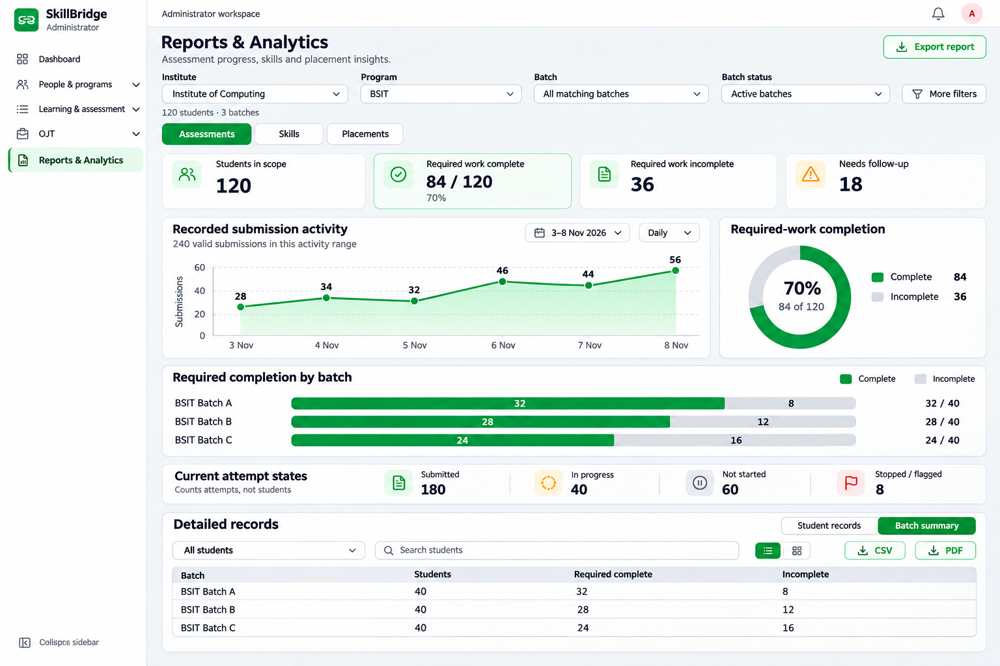
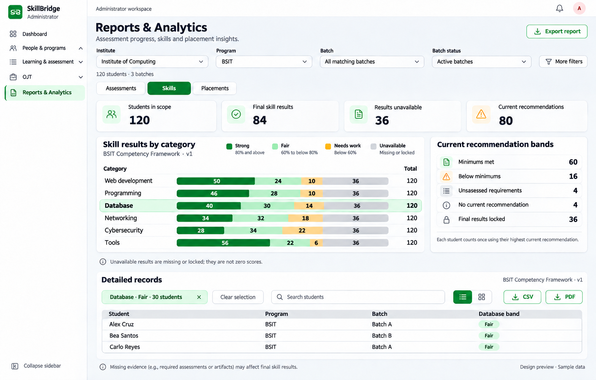
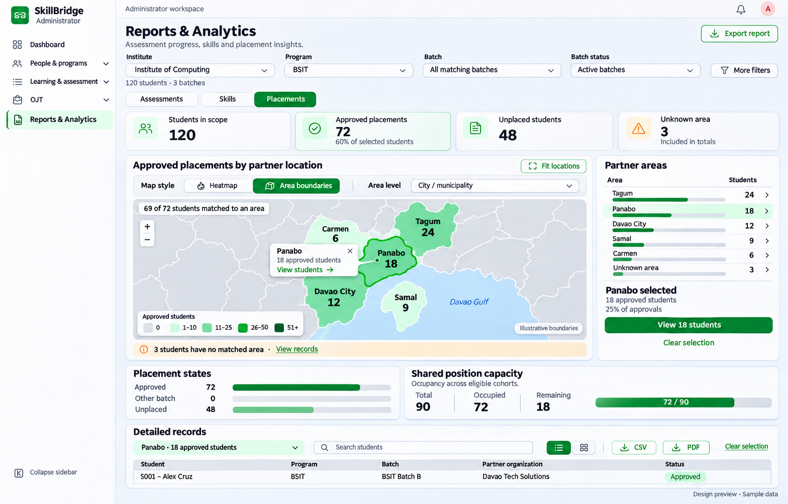
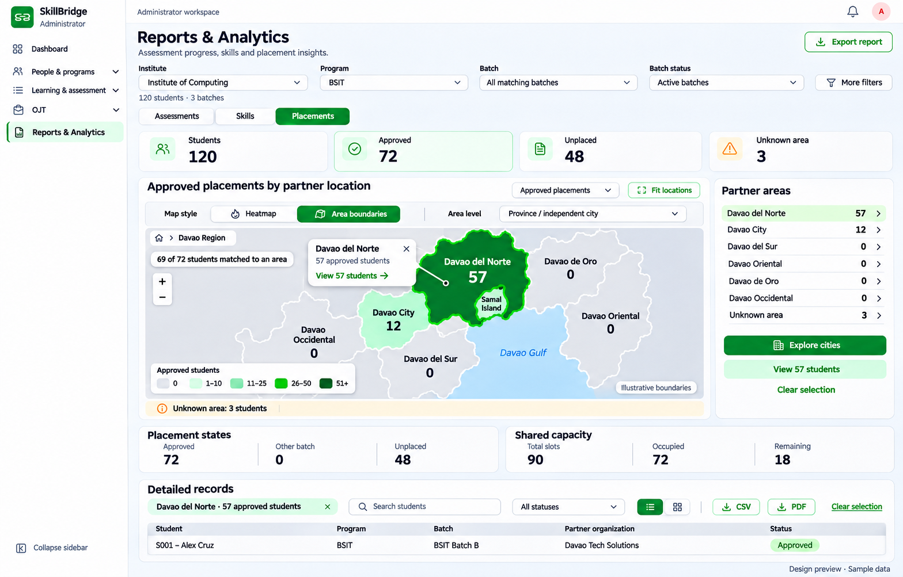
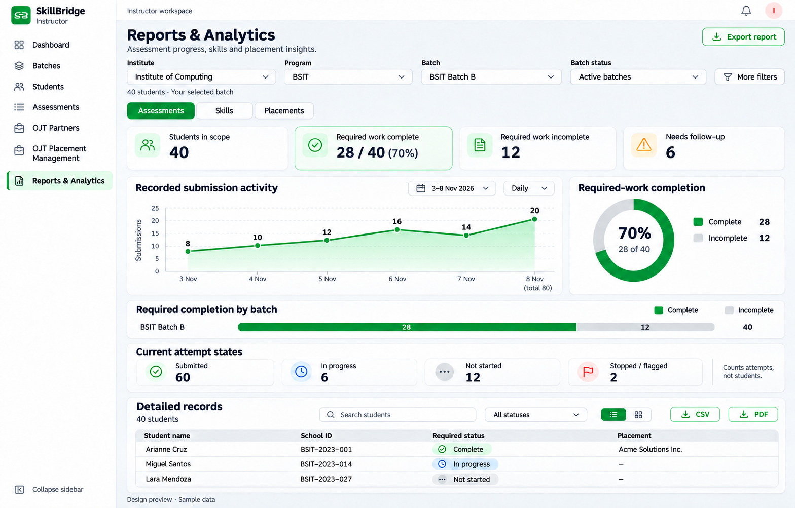
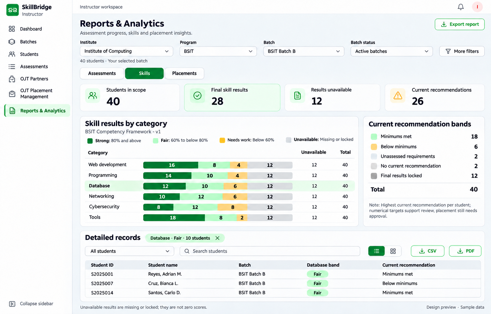
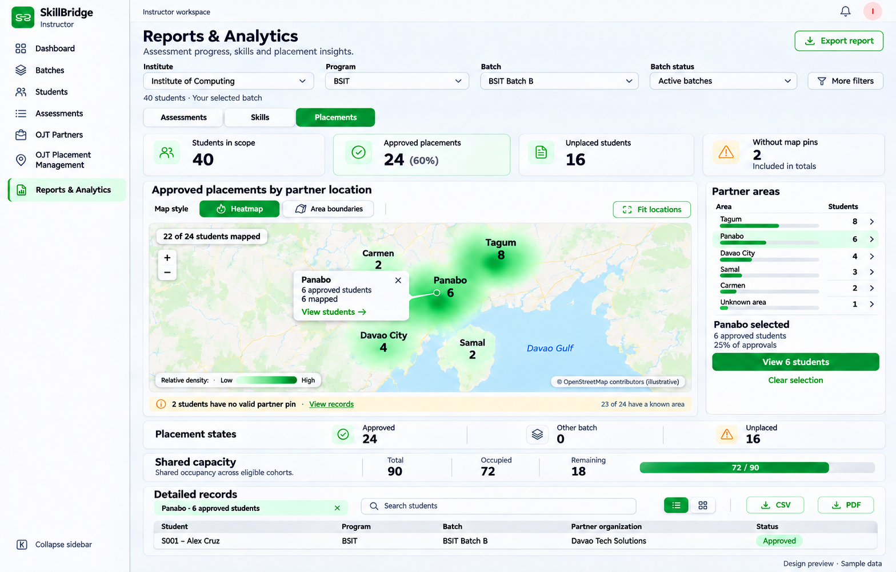
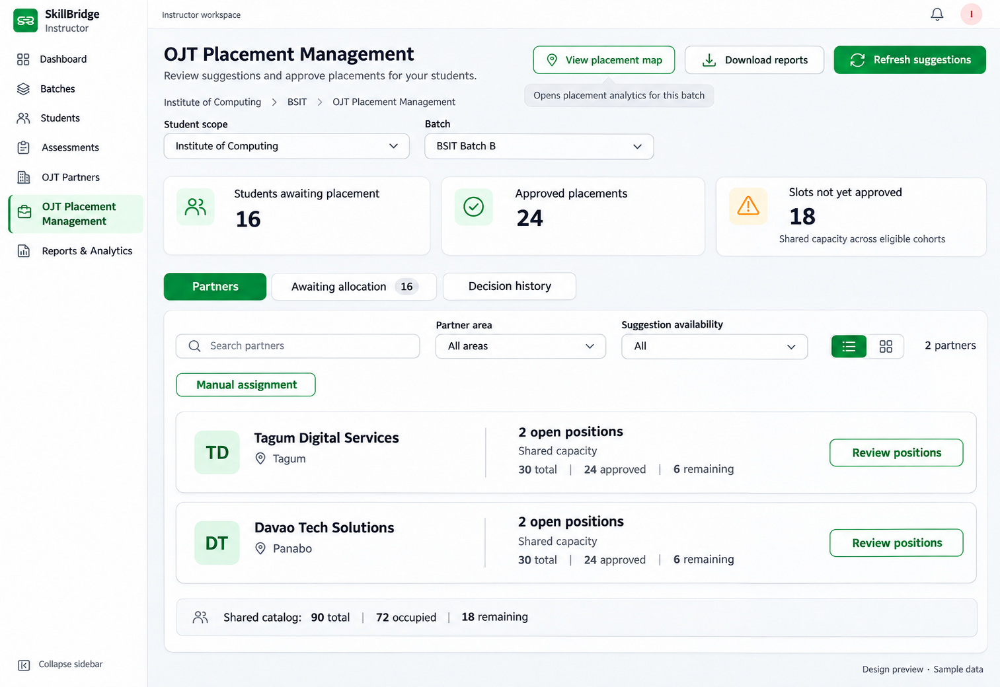

# Analytics UI preview gallery

Generated with built-in imagegen on 9 November 2026. These eight separate desktop
screens preview the planned SkillBridge analytics redesign. They are visual
review assets, not screenshots of an implemented feature. Figures and identities
are synthetic; map geography is illustrative.

The [implementation plan](../../../knowledge/ANALYTICS_CHARTS_AND_PLACEMENT_MAP_PLAN.md)
defines supported metrics, authorization, filters, canonical areas, boundary
sources and delivery checks. The [original concepts and inspirations](../analytics-review-2026-11-08/README.md)
remain saved. Application code and database records were not changed.

## Screen index

| Preview | What to review |
| --- | --- |
| [01 · Admin Assessments](01-admin-assessments.png) | Activity, completion ring, batch comparison, current attempts and records |
| [02 · Admin Skills](02-admin-skills.png) | Score-band bars, recommendation bands, missing evidence and selected records |
| [03 · Admin Placements: city boundaries](03-admin-placements-cities.png) | City/municipality polygons, exact-count list, missing areas and approved records |
| [04 · Instructor Assessments](04-instructor-assessments.png) | The same report structure restricted to an owned selected batch |
| [05 · Instructor Skills](05-instructor-skills.png) | Batch-scoped category evidence, recommendations and category-band selection |
| [06 · Instructor Placements: heatmap](06-instructor-placements-heatmap.png) | Weighted pins, heat/boundary switch, pin coverage and approved-only records |
| [07 · Admin Placements: province overview](07-admin-placements-provinces.png) | Province/independent-city level, zero areas and Explore cities action |
| [08 · Instructor placement workspace](08-instructor-placement-entry.png) | View placement map entry beside existing decision-workspace actions |

Both report roles use Heatmap / Area boundaries in the same map panel. The
gallery distributes the example styles between roles to show both clearly;
these are not exclusive role capabilities. Province / independent city and City /
municipality levels are available when boundary data is supported. The full map
belongs in Reports & Analytics → Placements. The placement workspace links to
it using the compatible current scope.

OJT Partners retains its partner-discovery purpose. Its optional shared styling
was not added to this core redesign preview set. No new student-tracking or OJT
completion workflow is implied.

## Admin · Assessments

## Admin · Skills

## Admin · Placements: city / municipality

## Admin · Placements: province / independent city

## Instructor · Assessments

## Instructor · Skills

## Instructor · Placements: heatmap

## Instructor · Placement workspace entry

## Review notes and provenance

- Admin examples show 120 students across three batches; instructor examples show
  BSIT Batch B with 40 students. Completion is 84/120 and 28/40 respectively.
- Admin approvals total 72, with 69 area-matched and 66 pin-mapped. Instructor
  approvals total 24, with 23 area-matched and 22 pin-mapped. A missing pin is
  separate from an unknown administrative area.
- Shared capacity uses 90 slots, 72 occupied and 18 remaining across eligible
  cohorts. It is separate from the instructor's 24 selected-student approvals.
  The workspace shows two example partner rows rather than the entire catalog.
- Score bands are Strong / Fair / Needs work. Recommendation bands are Minimums
  met / Below minimums / Unassessed requirements, with unavailable states kept
  separate. Numerical targets support review; placement still needs approval.
- These generated images guide hierarchy and appearance. Minor generated text,
  outline details, incidental record identities and spatial shapes are not a
  replacement for the written contracts. Render actual service-backed values,
  canonical boundaries, accessible controls and the existing shared navigation
  during implementation. A measure selector appears only if multiple supported
  measures are available; repeated helper copy should be removed.
- Source records: [initial screen prompts](IMAGEGEN_PROMPTS.md),
  [targeted refinements](REFINEMENT_PROMPTS.md) and [PNG checksums](ASSETS.sha256).
  Final PNGs are exact copies of the selected built-in imagegen outputs. All
  eight were visually reviewed; this task did not run application tests.
