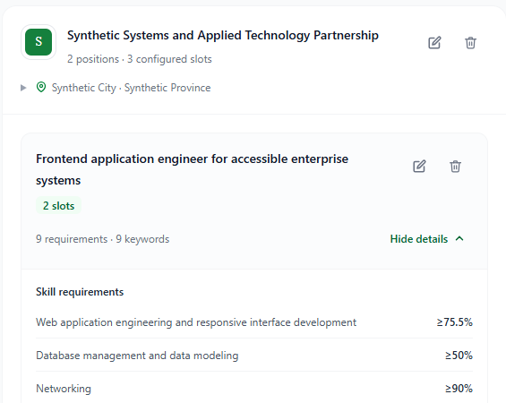
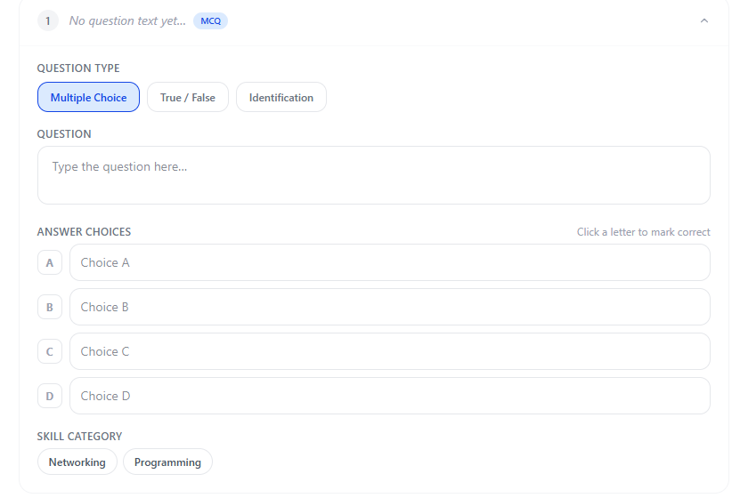
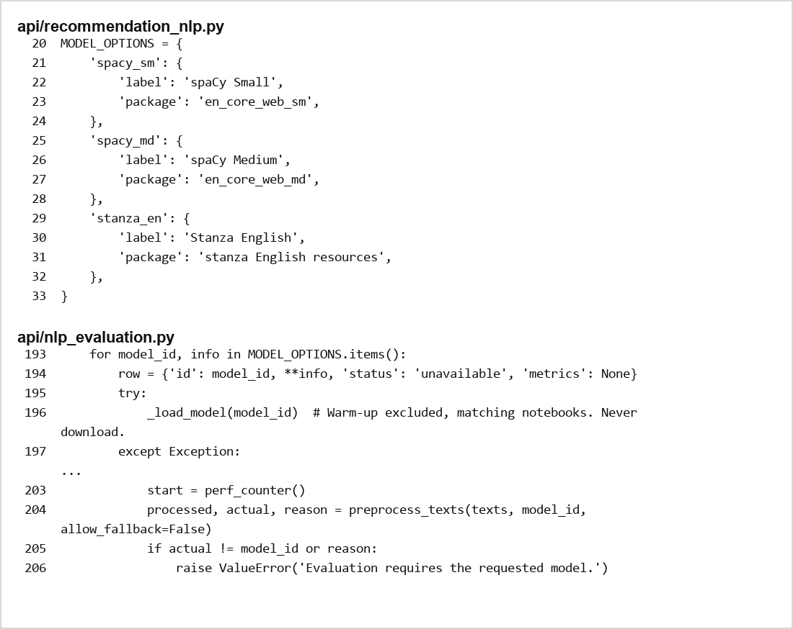
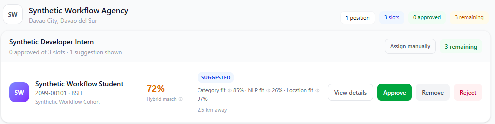
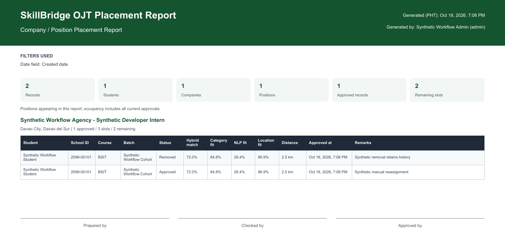

# Progress Report

**SKILLBRIDGE: A WEB-BASED OJT PLACEMENT DECISION SUPPORT SYSTEM WITH NLP-ASSISTED SKILLS ASSESSMENT AND COMPANY-POSITION RECOMMENDATION**

**Researchers:** David Rey P. Bali-os, Lemuel P. Brion and Azel M. Villanueva

**As of:** October 20, 2026 | **Pre-deployment defense:** November 9-10, 2026

**Draft status:** Updated Gantt chart and phase dates pending confirmation.

## Introduction

SkillBridge is a web-based decision support system for OJT placement at Davao del Norte State College. It brings together student information, competency assessments, company-position requirements, NLP-assisted matching, and placement analytics to help students and staff review suitable OJT opportunities.

This report covers development since the June 2, 2026 outline defense. The main workflows are implemented locally. Current work focuses on selected UI improvements, final validation, manuscript alignment and preparation for adviser review and the pre-deployment defense.

### Gantt Chart

The updated project Gantt chart will be inserted after the team completes its revision. The November 9-10 pre-deployment defense is a review milestone. The team tentatively expects development to end and deployment to begin in January, followed by maintenance through June. Exact dates, year labels and phase overlap will follow the updated chart.

The latest formal panel record is the June 2 outline-defense minutes. Another formal adviser check has not yet taken place; the team plans to request a check this week or next week.

<!-- pagebreak -->

## Project Status

SkillBridge is a working prototype undergoing refinement, local verification and deployment preparation. Implemented features address the five study objectives. Final hosted acceptance and formal user evaluation remain to be completed.

### Recent Accomplishments

- **Manage project information.** Implemented student profiles, company and position records, skill requirements, competency results, recommendations and placement records, with separate student, instructor and administrator access. Batch management and IAMS-format enrollment support student-record preparation.
- **Provide competency assessments.** Implemented assessment authoring and deployment, Multiple Choice, True/False and Identification questions, question import, randomized delivery, automatic scoring and category results. Timed attempts, authorized retakes and combined competency profiles support the assessment workflow.
- **Compare NLP preprocessors.** Developed a comparison workflow for spaCy Small, spaCy Medium and Stanza English, with recommendation metrics, processing-time records and explicit reporting of unavailable models. Final interpretation and manuscript alignment remain under review.
- **Generate hybrid recommendations.** Implemented company-position ranking using category, NLP-assisted text and location similarity with 60%, 25% and 15% weights. Staff review suggestions before approval; assessment completion and capacity are checked separately. Recent safeguards detect outdated matching inputs and require refreshed recommendations.
- **Provide analytics and reports.** Implemented role-specific dashboards and reports for assessment completion, competency results, recommendations, placements and remaining slots. Recent local improvements include clearer student tables, chart drill-downs and scoped exports.

### Challenges and Solutions

During development and internal checking, the team addressed the following technical issues.

- **Maintaining accurate assessment scores.** Internal checks identified inconsistent handling of unanswered questions and invalid answer submissions. We revised validation and grading so that each assessment question contributes to the correct category total, and added checks for incomplete answers, retakes and repeated submissions.
- **Handling slow or uncertain submissions.** Initial model loading and recommendation processing could delay submission feedback. We extended the submission wait and added a check of the recorded attempt after a failed response, allowing the interface to recognize a saved result while retaining answers when saving is unconfirmed. Further performance refinement remains ongoing.
- **Keeping recommendations consistent with updated records.** Changes to position requirements could leave older matches available for review. We added matching-input checks, blocked outdated results and provided an explicit refresh while retaining previous placement records.
- **Managing administrator and instructor responsibilities.** Assessment and batch workflows needed clearer ownership and broader administrator controls. We added shared authoring, instructor assignment, scoped batch management and action history while enforcing role boundaries.
- **Presenting results clearly and consistently.** Several pages needed clearer grouping, tables, navigation and feedback. We improved dashboards, report views, student company details and shared notifications. Refinement of selected pages continues under Work in Progress.

<!-- pagebreak -->

### Comparison of Actual Progress to the Planned Timeline

The core application workflows are implemented locally, while interface refinement, regression verification and research-document alignment continue. Adviser review and the November pre-deployment defense remain upcoming milestones. Final testing, deployment and maintenance dates will be compared with actual progress once the updated Gantt chart is available. The report does not assume that development or deployment must be completed by the November defense.

## Work Completed

- **Data and account management:** Built role-based workflows for student records, batches, companies, positions, requirements and OJT placement records.
- **Assessment workflow:** Built question authoring and import, assessment deployment, timed answering, scoring, category results and instructor-controlled retakes.
- **Combined competency evidence:** Added batch-scoped competency profiles and required-assessment completion checks for recommendation access.
- **NLP comparison tools:** Added model comparison and diagnostics that identify the actual model used and distinguish failed or unavailable models from completed runs.
- **Recommendations and placement review:** Built ranked matches, separate score components, staff approval controls, capacity checks and saved placement snapshots.
- **Analytics and report generation:** Built scoped dashboards, assessment and placement summaries, student detail views and downloadable reports. Recent local work improves table consistency and interactive charts.
- **Verification and readiness records:** Prepared local automated and browser checks, an independent code review, a response matrix for the 17 panel comments, and release/recovery guidance.

The following pages show selected UI screens, a source-code excerpt and a generated report. These provide direct evidence of implemented work alongside the separate technical verification records.

UI and report examples were captured locally on October 17-18 using synthetic records; the code excerpt was prepared on October 20. The figures show implementation, rather than hosted acceptance or actual placement outcomes.

<!-- pagebreak -->

### Evidence of Work: Code, Interfaces and Generated Output

- **Company and position management:** The interface shows a position, available slots and required skill levels for placement preparation.

**Figure 1.** Companies and Positions interface with a synthetic company record, position, slots and requirements. Local UI fixture, October 17.

- **Assessment authoring:** The editor provides question types, answer fields and skill-category controls.

**Figure 2.** Assessment authoring controls from the local prototype, October 18. Scoring verification is recorded separately.

<!-- pagebreak -->

### Evidence of Work: NLP Comparison and Recommendations

- **NLP comparison:** The model registry and evaluation loop configure three preprocessors and check the actual model used during strict comparison. Source filenames appear in the excerpt.

**Figure 3.** Labeled source-code excerpts prepared October 20. This shows comparison implementation; experiment results and final model selection require separate explanation.

- **Ranked suggestions:** Staff can inspect a student's suggested position, total match, category/NLP/location components, distance and available capacity before making a placement decision.

**Figure 4.** Synthetic company-position suggestion from a local React/API demonstration, October 18. Match values are illustrative; approval remains a separate staff action.

<!-- pagebreak -->

### Evidence of Work: Analytics and Report Generation

- **Placement reporting:** The company placement workflow produces a PDF containing placement history, match components and remaining capacity.

**Figure 5.** Detail of a report downloaded from the local workflow on October 18. Synthetic Removed and Approved entries illustrate retained history and capacity reporting. Blank signature fields do not represent approval or endorsement.

### Supporting Verification

Local checks cover assessment handling, access boundaries, recommendations, placement rules, reports and selected browser workflows. The independent review and subsequent project records retain the exact commands, observations and limitations. Later project records document fixes to recommendation freshness and category validation, as well as additional dashboard and analytics checks.

These records support the implementation evidence shown above. They do not replace genuine participant evaluation or verification of the intended hosted release.

The original screenshots and figure provenance are retained with the editable report. The earlier captures do not show every subsequent UI refinement or every implemented feature.

<!-- pagebreak -->

## Work in Progress

We are currently improving the UI of selected pages to make layouts, information presentation and navigation more consistent. Work includes dashboard and Reports & Analytics refinements, regression checks, manuscript/model alignment, and preparation for adviser review. Hosted integration, recovery verification and genuine user acceptance activities remain part of the completion plan.

### Anticipated Completion Dates

The activity dates will follow the updated Gantt chart. Work still to schedule or complete includes adviser review, selected UI improvements, local regression checks, manuscript/model alignment, formal user acceptance, intended-environment migration and deployment/recovery verification. Development completion, deployment start and the maintenance period remain subject to the team's revised chart.

## Conclusion

### Key Findings and Achievements

SkillBridge now supports the main assessment-to-placement workflow through managed project records, competency assessments, NLP comparison tools, hybrid recommendations and analytics/reporting. The selected figures demonstrate concrete implementation progress since the outline defense.

### Assessment of Project Progress Against Goals

The working prototype addresses the five study objectives. Selected UI refinements, research-document alignment and final validation continue. Readiness for actual use still depends on confirming the intended hosted release and completing genuine user evaluation and adviser review.

### Plans and Next Steps

- **Before the November 9-10 defense:** Seek adviser review, check panel-action responses, present current implementation evidence and prepare the demonstration.
- **During the remaining development and validation period:** Continue selected UI refinements, verify the intended release, reconcile the manuscript and complete formal evaluation according to the updated schedule.
- **Deployment and maintenance:** Use the updated Gantt chart to confirm the tentative January transition and maintenance through June, including hosting, user orientation, issue monitoring and recovery responsibilities.
