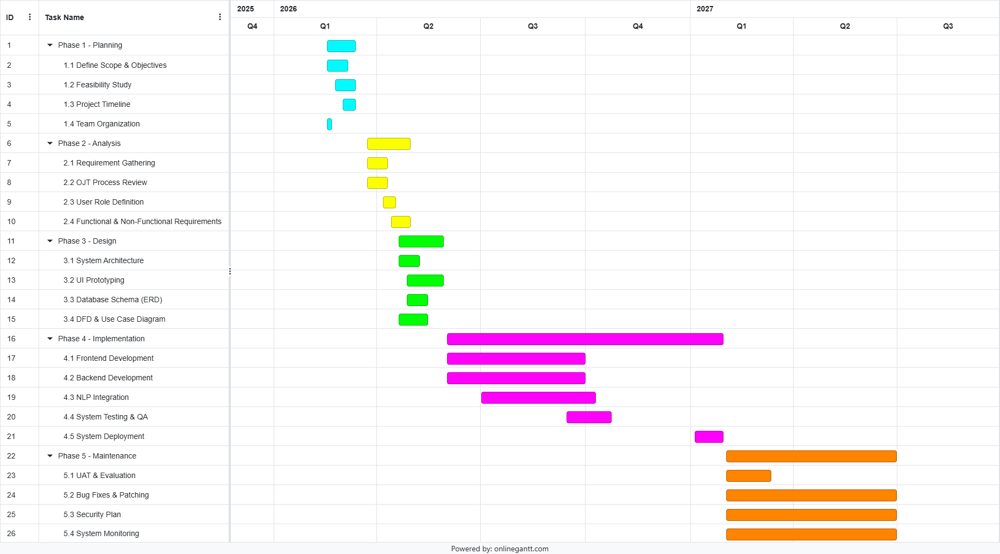

# Progress Report

**SKILLBRIDGE: A WEB-BASED OJT PLACEMENT DECISION SUPPORT SYSTEM WITH NLP-ASSISTED SKILLS ASSESSMENT AND COMPANY-POSITION RECOMMENDATION**

**Researchers:** David Rey P. Bali-os, Lemuel P. Brion and Azel M. Villanueva

**As of:** October 20, 2026

**Pre-deployment defense:** Informal: November 11-13, 2026 | Formal: November 16-17, 2026

## Introduction

SkillBridge supports OJT placement decisions at Davao del Norte State College through student records, competency assessments, company-position requirements, NLP-assisted matching and analytics. This report presents progress since the June 2, 2026 outline defense. The system is in Implementation, with working core features and continuing UI refinement and local verification.

### Updated Gantt Chart

The revised schedule runs from planning in early 2026 to maintenance in June 2027. Implementation extends through January 2027, including system deployment in January. Maintenance runs approximately February-June 2027, with UAT and evaluation in February-March. The November informal and formal defenses are separate review milestones.

The team-supplied chart is reproduced unchanged. A larger landscape copy appears at the end. Month ranges are approximate readings of the quarter-based image; exact day-level dates are not inferred.

<!-- pagebreak -->

## Project Status

SkillBridge is a working prototype in the Implementation phase. Core workflows are implemented locally; selected UI improvements, regression verification and manuscript alignment continue. Hosted deployment and formal user evaluation remain upcoming activities.

### Recent Accomplishments

- **Manage project information.** Implemented student profiles, company and position records, skill requirements, competency results, recommendations and placement records, with separate role access. Batch management, instructor assignment and IAMS-format enrollment support record preparation.
- **Provide competency assessments.** Implemented authoring and import, Multiple Choice, True/False and Identification questions, randomized delivery, automatic scoring and category results. Timed attempts, authorized retakes and combined competency profiles support the assessment workflow.
- **Compare NLP preprocessors.** Developed comparison tools for pretrained spaCy Small, spaCy Medium and Stanza English pipelines, with recommendation metrics, timing records and explicit reporting of unavailable models. Final interpretation and manuscript alignment continue.
- **Generate hybrid recommendations.** Implemented ranking using category, NLP-assisted text and location similarity with 60%, 25% and 15% weights. Completion, capacity and staff approval remain separate checks. Updated safeguards block outdated matches until refreshed.
- **Provide analytics and reports.** Implemented dashboards and reports for assessment completion, competency results, recommendations, placements and remaining slots, with clearer student tables, chart drill-downs and scoped exports.

### Challenges and Solutions

Development and internal checking identified the following issues and responses.

- **Accurate assessment scores.** Unanswered questions and invalid submissions required more consistent handling. We revised answer validation and full-question category totals, with checks for incomplete answers, retakes and repeated submissions.
- **Slow or uncertain submissions.** Model loading and recommendation processing could delay feedback. We extended the submission wait and check the recorded attempt after failed responses, recognizing saved results while retaining unconfirmed answers. Performance refinement continues.
- **Recommendations after record changes.** Updated position requirements could leave older matches available. We added matching-input checks, blocked outdated results and provided an explicit refresh while preserving placement history.
- **Clear staff responsibilities.** Assessment and batch workflows needed clearer ownership and administrator controls. We added shared authoring, instructor assignment, scoped management and action history while enforcing role boundaries.
- **Consistent result presentation.** Several pages needed clearer grouping, navigation and feedback. We improved dashboards, report views, company details and shared notifications. Selected page refinements remain ongoing.

<!-- pagebreak -->

### Comparison of Actual Progress to the Planned Timeline

The revised Gantt chart provides the phase windows below. Earlier planning, analysis and design outputs are available, but their exact actual completion dates were not independently established. Current code and local verification support the implementation status shown.

| Phase or activity | Planned window | Progress as of October 20, 2026 |
| --- | --- | --- |
| Planning | Feb-Mar 2026 | Scope, study objectives and project schedule documented. |
| Analysis | Mar-Apr 2026 | OJT process, roles and requirements documented. |
| Design | Apr-May 2026 | Architecture, UI and database/data-flow designs available; refinements continue. |
| Implementation | Jun 2026-Jan 2027 | In progress. Core workflows implemented; local checks and UI refinement continue. |
| System Testing & QA | Sep-Oct 2026 | In progress. Local checks have been conducted; remaining verification continues. |
| System Deployment | Jan 2027 | Not yet started. |
| UAT & Evaluation | Feb-Mar 2027 | Not yet started. |
| Maintenance | Feb-Jun 2027 | Not yet started. |

The frontend/backend development bars end around September 2026, while NLP integration and QA extend into October. Selected UI refinements are still ongoing after the core-development window and are not shown as a separate bar. Exact schedule variance is not calculated from the image alone.

<!-- pagebreak -->

## Work Completed

- **Data and account management:** Built role-based workflows for student records, batches, companies, positions, requirements and OJT placement records.
- **Assessment workflow:** Built question authoring and import, assessment deployment, timed answering, scoring, category results and instructor-controlled retakes.
- **Combined competency evidence:** Added batch-scoped competency profiles and required-assessment completion checks for recommendation access.
- **NLP comparison tools:** Integrated pretrained preprocessing pipelines with model comparison and diagnostics. TF-IDF/cosine similarity supports text matching; diagnostics identify the actual model and unavailable runs. The application does not train a new language model.
- **Recommendations and placement review:** Built ranked matches, separate score components, staff approval controls, capacity checks and saved placement snapshots.
- **Analytics and report generation:** Built scoped dashboards, assessment and placement summaries, student detail views and downloadable reports. Recent local work improves table consistency and interactive charts.
- **Verification and readiness records:** Prepared local automated and browser checks, an independent code review, a response matrix for the 17 panel comments, and release/recovery guidance.

The following evidence pages are prepared for the team's own screenshots, source-code captures and generated outputs. Replace each labeled box with the specified capture, keep the figure caption below it and complete the actual capture date. Use synthetic demonstration records consistently across the figures.

The captions are drafts: check that they describe the inserted evidence accurately. Remove the capture instructions and placeholder boxes before final submission. Eight figure groups cover project information, assessment authoring/results, NLP comparison, recommendations and analytics/report output.

<!-- pagebreak -->

## Evidence of Work

### Manage Project Information

**Capture:** Admin > Companies: expand a company, a position and its skill requirements. Then capture Admin > Batches with the selected instructor and demonstration student roster.

<!-- capture-slot {"height": 185, "title": "Figure 1(a) - Company and position records", "detail": "Admin > Companies | Position, slots and required skill levels"} -->

<!-- capture-slot {"height": 185, "title": "Figure 1(b) - Student and batch records", "detail": "Admin > Batches | Selected batch, instructor and demo roster"} -->

**Figure 1.** Project information management showing (a) company positions, available slots and skill requirements and (b) the selected batch's instructor and enrolled students. Localhost demonstration using synthetic data. Capture date: __________.

<!-- pagebreak -->

### Provide Competency Assessments - Authoring

**Capture:** Instructor or Admin > New Assessment. Show prepared Multiple Choice, True/False and Identification examples, answer-key controls and skill categories. Use a saved example opened for editing when available. If necessary, combine two readable panels in the area below.

<!-- capture-slot {"height": 360, "title": "Figure 2 - Assessment authoring", "detail": "New Assessment | Question types, answer controls and skill categories"} -->

**Figure 2.** Assessment authoring interface showing supported question types, answer-key controls and skill-category assignments. Localhost demonstration using synthetic questions. Capture date: __________.

This figure documents question preparation. The next figure records generated assessment results.

<!-- pagebreak -->

### Provide Competency Assessments - Generated Results

**Capture:** Student > Assessments > open a completed assessment's results. Include the assessment title, raw/maximum score, percentage and Category scores. Keep this individual assessment result distinct from the combined competency view.

<!-- capture-slot {"height": 360, "title": "Figure 3 - Automatically generated assessment results", "detail": "Student assessment results | Raw score, percentage and category scores"} -->

**Figure 3.** Automatically generated assessment results showing the student's raw score, overall percentage and scores by skill category. Localhost demonstration using a completed synthetic assessment. Capture date: __________.

<!-- pagebreak -->

### Compare NLP Preprocessors - Comparison Output

**Capture:** Admin > Reports & Analytics > Advanced > NLP model comparison. Use Prepared evaluation dataset, run the comparison and show the dataset scope, model availability, ranking metrics and processing time. Alternatively, insert the actual study comparison output and identify its dataset/run accurately.

<!-- capture-slot {"height": 330, "title": "Figure 4 - Actual NLP comparison output", "detail": "Model names and availability | Dataset, metrics and processing time"} -->

**Figure 4.** NLP preprocessing comparison output showing the available model results, model availability, ranking metrics and processing time for the identified evaluation dataset. Evaluation mode/dataset: __________. Run/capture date: __________.

**Caption check:** Preserve unavailable/error statuses. An empty comparison interface shows preparation only; if the evaluation has not run, describe the work as comparison tools implemented and evaluation in progress. Synthetic evaluation metrics are not actual OJT success rates.

<!-- pagebreak -->

### Compare NLP Preprocessors - Source Code

**Capture:** In your editor, show MODEL_OPTIONS in api/recommendation_nlp.py and the model loop in api/nlp_evaluation.py, including preprocess_texts with allow_fallback=False and the actual-model check. Keep filenames and line numbers visible; use two readable panels if needed.

<!-- capture-slot {"height": 355, "title": "Figure 5 - NLP registry and strict comparison code", "detail": "recommendation_nlp.py: MODEL_OPTIONS | nlp_evaluation.py: model loop"} -->

**Figure 5.** Source-code excerpts defining the NLP preprocessing candidates and executing strict model comparison without substituting fallback-model results. Captured from the local source code. Capture date: __________.

This code documents implementation. Pair it with the executed comparison output in Figure 4. The application integrates pretrained pipelines rather than training a new language model.

<!-- pagebreak -->

### Generate Hybrid Recommendations

**Capture:** (a) Student > Skill Profile and Matches: show current ranked matches and a company's position details. (b) Staff > Placements: expand the same demonstration case and show score components and capacity. Use existing demo state without approving a placement just for the image.

<!-- capture-slot {"height": 190, "title": "Figure 6(a) - Student company-position matches", "detail": "Student > Skill Profile and Matches | Current ranking and position details"} -->

<!-- capture-slot {"height": 190, "title": "Figure 6(b) - Staff score and capacity review", "detail": "Staff > Placements | Category, NLP, location, total match and slots"} -->

**Figure 6.** Hybrid recommendation results showing (a) the student's ranked company-position matches and (b) staff review of the score components and available placement capacity. Localhost demonstration using synthetic data. Capture date: __________.

A match is a similarity score and supports a separate coordinator placement decision.

<!-- pagebreak -->

### Provide Analytics and Reports - Interface

**Capture:** Reports & Analytics: choose the demonstration scope. Capture (a) Skills with a competency chart and supporting records and (b) Placements with placement status and capacity. Keep the relevant scope/filter visible.

<!-- capture-slot {"height": 190, "title": "Figure 7(a) - Skills analytics", "detail": "Reports & Analytics > Skills | Competency chart and supporting table"} -->

<!-- capture-slot {"height": 190, "title": "Figure 7(b) - Placement analytics", "detail": "Reports & Analytics > Placements | Status summaries and company capacity"} -->

**Figure 7.** Reports and analytics showing (a) competency summaries and supporting records and (b) placement status and company-position capacity for the selected scope. Localhost demonstration using synthetic data. Capture date: __________.

<!-- pagebreak -->

### Provide Analytics and Reports - Generated Output

**Capture:** Placements > Download placement reports > Company / position placements > Download PDF. Open the saved file and show its title, filters, records and capacity summary. Retain the original exported file. If using an analytics export instead, adapt the caption to the actual output.

<!-- capture-slot {"height": 295, "title": "Figure 8 - Exported PDF report", "detail": "Open the saved output | Report title, filters, records and summary"} -->

**Figure 8.** System-generated company/position placement report showing the selected filters, placement records and capacity summary. Exported from the localhost demonstration using synthetic data. Capture date: __________.

### Supporting Verification

The latest code rescan recorded 135 passing frontend unit tests and passing lint/build checks. The isolated SQLite backend run discovered 347 tests: 335 passed and 12 PostgreSQL-specific tests were skipped. These checks support implementation evidence; they are not participant-evaluation or model-effectiveness results.

Earlier local browser/PostgreSQL records remain supporting history. Hosted verification remains pending. The image fields in this draft are intentionally blank until the team inserts its actual captures and checks the captions.

<!-- pagebreak -->

## Work in Progress

Selected UI refinements, regression checks, manuscript alignment and evidence capture continue. We target adviser review October 26-31 and fixes/retesting November 1-7. The latest formal panel record is the June 2 outline-defense minutes.

### Anticipated Completion and Activity Windows

| Task | Planned timing |
| --- | --- |
| Adviser review of current system and manuscript | October 26-31, 2026 (target) |
| Apply adviser feedback, fix issues and retest revisions | November 1-7, 2026 (target) |
| Informal pre-deployment defense | November 11-13, 2026 |
| Formal pre-deployment defense | November 16-17, 2026 |
| UI refinement, evidence capture and manuscript alignment | Ongoing during Implementation |
| System deployment and intended-environment verification | January 2027 |
| UAT and formal evaluation | Approximately February-March 2027 |
| Bug fixes, security activities and system monitoring | Approximately February-June 2027 |

Adviser review dates are targets, not a confirmed appointment. The defense schedule supplements the Gantt; local checks remain separate from formal UAT/evaluation.

## Conclusion

### Key Findings and Achievements

SkillBridge implements project records, assessments, NLP comparison tools, hybrid recommendations and analytics/reports. The prepared evidence section will document these workflows using the team's actual captures.

### Assessment of Project Progress Against Goals

The prototype addresses the five study objectives, with UI refinement and verification continuing within Implementation. Readiness for actual use still requires intended-environment checks, genuine user evaluation and adviser review.

### Plans and Next Steps

- **Late October-early November:** Seek adviser review October 26-31 and apply and verify requested revisions November 1-7.
- **November defenses:** Present at the November 11-13 informal defense, address feedback and prepare for the November 16-17 formal defense.
- **January-June 2027:** Prepare for January deployment, followed by scheduled UAT/evaluation and maintenance through June.
